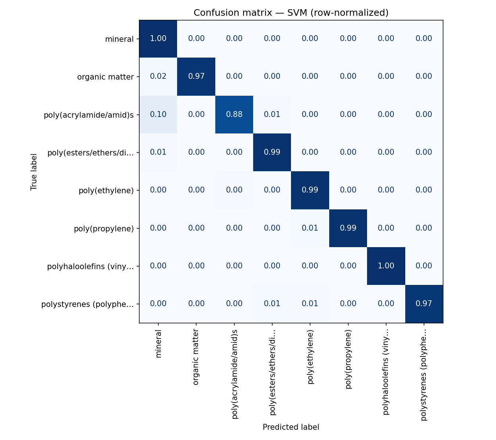
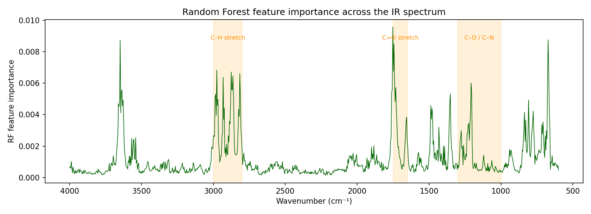
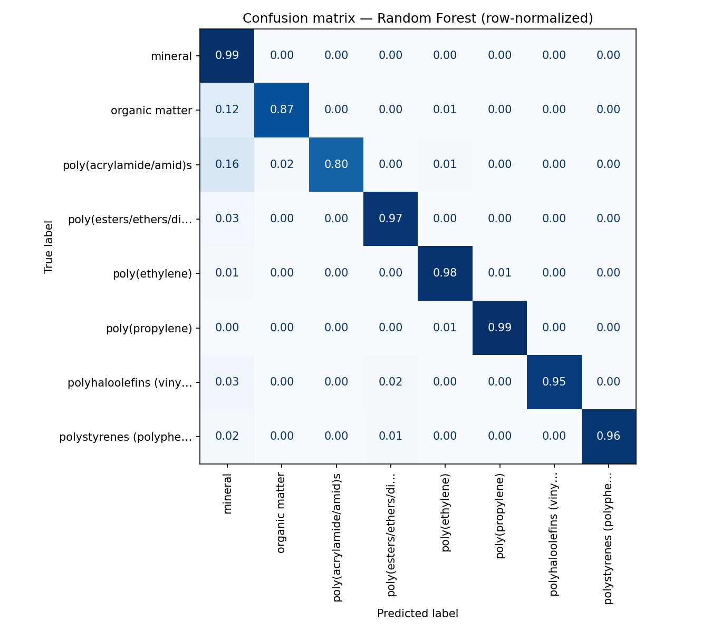

# ir-spectra-analyzer

**Classify the material behind an FTIR spectrum — polymer, mineral, or organic matter — and read the chemistry the model used to decide.**

A reproducible FTIR pipeline that takes a raw infrared spectrum, runs the
classical signal-processing chain a spectroscopist would (baseline correction,
smoothing, peak detection, functional-group assignment), and then predicts the
**material class** with a machine-learning model trained on the open
[OpenSpecy](https://www.openspecy.org/) reference library. It ships an
interpretable rule-table baseline, an SVM, and a Random Forest, compared
head-to-head with leakage-aware evaluation — the project is as much about
*honest method validation* as about the final score.

The 8 classes span polymers, minerals, and organic matter, so the task mirrors
a real industrial use case: **microplastic screening — telling polymers apart
*from* the minerals and organic debris they're found alongside.**

## Results

Three classifiers on the **same** held-out 20% test set (4,113 spectra never
seen during training or tuning), scored by **F1-macro** (every class weighted
equally, so rare classes can't hide behind the common ones):

| Model | F1-macro |
|---|---:|
| **SVM** (RBF kernel) | **0.976** |
| Random Forest | 0.957 |
| Rule-table baseline | 0.097 |



The SVM's confusion matrix is near-diagonal — every class lands at 0.88–1.00,
with the only notable confusion being the smallest class
(poly(acrylamide/amid)s) occasionally read as mineral. The Random Forest is a
hair behind but earns its place by being **interpretable** (see below). The
rule baseline scores poorly *on purpose* — see
[Methodology & honest caveats](#methodology--honest-caveats).

## Methodology & honest caveats

The headline number is easy to inflate by accident. The choices below are the
guardrails against that — and the part a reviewer should read most closely.

- **Leakage-aware evaluation.** A stratified 20% slice is locked away *before*
  any tuning. Hyperparameters are chosen by cross-validation on the remaining
  80% only; the final F1-macro is measured **once** on the untouched 20%. No
  parameter ever "sees" the test set, so the score isn't optimistic.
- **Per-fold scaling.** The SVM's `StandardScaler` is fit *inside* each
  cross-validation fold (via a scikit-learn `Pipeline`), so a fold's own
  mean/variance never leaks into its training. The Random Forest uses **no
  scaler** at all — tree splits are scale-invariant, so standardizing would be
  a misleading no-op. Preprocessing is model-dependent, and the code says so.
- **Low-replication assumption, stated and measured.** OpenSpecy is a *curated
  reference* library (≈ one spectrum per material), so a plain
  `StratifiedKFold` is honest here — there are no near-duplicate replicates of
  the same physical sample leaking across the split. This isn't assumed: exact
  duplicate prevalence was measured at **1 / 21,542 (< 0.01%)**, which backs
  the assumption. Group-aware splitting would be overkill for this dataset.
- **Class imbalance is weighted, not dropped.** The rare tail is cut **once**
  (an 8-class, ≥300-spectra cutoff → 20,563 spectra), then every surviving
  sample of every class is kept and `class_weight='balanced'` handles the
  remaining imbalance. No down-sampling of the common classes.
- **Why the rule baseline scores 0.10 — and why that's the honest number.**
  Real spectra are peak-rich (~18 detected peaks each), so a raw-count rule
  table hits ties constantly, and ties resolve to `"Unknown"` — the baseline
  collapses to `"Unknown"` ~60% of the time. It would be easy to tune the rules
  into a flattering number; instead the baseline is kept as-locked and its
  failure mode is reported. A weak-but-honest baseline is the right
  comparator: it shows *how much* the ML models actually add.
- **The Random Forest learned the chemistry.** Its feature importances peak
  exactly on the diagnostic IR bands — C–H stretch, the C=O carbonyl (~1715
  cm⁻¹, the single most important feature), C–O / C–N, and O–H (~3650 cm⁻¹) —
  recovered with no chemical priors, purely from the labelled spectra.




The 8 classes are: `poly(ethylene)`, `poly(propylene)`, `polystyrenes`,
`poly(esters/ethers/diglycidylethers/terephthalates)s`,
`poly(acrylamide/amid)s`, `polyhaloolefins`, `mineral`, and `organic matter`.
The last three (and the polyester family) are deliberately broad catch-all
buckets — a single `mineral` label covers many distinct materials — which makes
the classification problem realistically hard rather than a clean toy set.

## Install

```bash
pip install -r requirements.txt
```

Pure Python for everyday use. **Reproducing the dataset from scratch**
additionally needs R + the [OpenSpecy R package](https://github.com/wincowgerDEV/OpenSpecy-package)
(used once to export the reference library — see
[Reproduce from scratch](#reproduce-from-scratch)).

## Usage

Analyze a single spectrum (CSV with `wavenumber,intensity` columns):

```bash
python scripts/run_analysis.py --input data/sample_spectra.csv
```

This prints the full spectrum report — detected peaks, functional-group
assignments, likely compound classes — **and** the model's prediction:

```
  Predicted material: mineral  (92.5% confidence)
  Runners-up: poly(esters/ethers/diglycidylethers/terephthalates)s 1.8%, organic matter 1.6%
```

The runners-up are shown deliberately: a confident "92% mineral" and a coin-flip
"51% mineral / 47% PE" are very different signals, and a chemometrician wants to
see the model's uncertainty, not just its top guess.

Useful flags:

| Flag | Effect |
|---|---|
| `--no-classify` | Skip ML classification; print the spectrum report only |
| `--output results.json` | Save the full report + prediction as JSON |
| `--plot` | Show the spectrum with annotated peaks |
| `--transmittance` | Treat input as %T and convert to absorbance |
| `--no-baseline` | Skip ALS baseline correction |

Classification is **on by default** and degrades gracefully: the trained model
(`models/*.joblib`) isn't committed, so on a fresh clone the CLI prints the
report plus a one-line hint to train the model, rather than crashing.

## Reproduce from scratch

The OpenSpecy download and the derived `.npz` artifacts are gitignored (large,
regenerable). To rebuild everything:

```bash
# 1. Download the OpenSpecy reference library and export it to CSV.
#    download_openspecy() fetches derivative.rds from OSF (DOI 10.17605/OSF.IO/X7DPZ);
#    export_to_csv() shells out to Rscript (the .rds is an OpenSpecy R6 object that
#    Python can't unpickle), producing wavenumbers/spectra/metadata CSVs, FTIR-only.
python -c "from src.data_acquisition import download_openspecy, export_to_csv; \
           download_openspecy(); export_to_csv()"

# 2. Assemble the training set: measure duplicates, drop exact dupes,
#    filter to the 8 best-populated classes, save training_set.npz.
python -c "from src.classifier import assemble_training_set; assemble_training_set()"

# 3. Build the feature matrix: resample each spectrum to the fixed
#    600–4000 cm⁻¹ / 4 cm⁻¹ grid (851 features), preprocess, cache features.npz.
python -c "from src.classifier import build_features; build_features()"

# 4. Train + compare baseline vs SVM vs RF; write the figures to reports/.
python scripts/compare_models.py

# 5. Persist the winning SVM (refit with probability=True for confidences).
python scripts/persist_model.py
```

After step 5 the CLI in [Usage](#usage) will classify against the freshly
trained model.

## How it works

1. **Signal processing** (`preprocessing.py`, `peak_detection.py`) — ALS
   baseline correction, Savitzky-Golay smoothing, min-max normalization, then
   prominence-based peak detection.
2. **Feature engineering** (`classifier.py`) — each spectrum is resampled onto a
   fixed **600–4000 cm⁻¹ grid at 4 cm⁻¹ steps (851 features)** and fed to the ML
   models *as the full spectrum*. Peaks are **not** the ML feature — they feed
   the human-readable report and the rule baseline only.
3. **Two parallel "opinions"** — a classical, interpretable rule-table baseline
   (`polymer_rules.py`, characteristic peak ranges per class) and the trained
   ML models (`classifier.py`). The CLI shows both the spectroscopist's report
   and the model's prediction.

## Project structure

```
src/
  loader.py            # CSV spectrum loader
  preprocessing.py     # ALS baseline, Savitzky-Golay, normalization
  peak_detection.py    # prominence-based peak detection
  functional_groups.py # IR functional-group assignment table (the report)
  polymer_rules.py     # rule-table baseline (characteristic peaks per class)
  data_acquisition.py  # OpenSpecy download + R-export-to-CSV + loader
  classifier.py        # feature engineering, SVM + RF, compare, persist, predict
  analyzer.py          # end-to-end report (preprocess → peaks → groups)
  config.py            # shared constants (grid, CV params, paths)
scripts/
  run_analysis.py      # CLI entry point (report + prediction)
  compare_models.py    # baseline vs SVM vs RF → reports/ figures
  persist_model.py     # train + save the winning model bundle
data/openspecy/        # OpenSpecy download + derived .npz (gitignored)
models/                # trained model bundle (gitignored)
reports/               # committed comparison figures
tests/                 # pytest suite (54 tests)
```

## Testing

```bash
python -m pytest
```

The suite (54 tests) covers the signal-processing half and the ML half,
including a synthetic-model fixture so the classifier tests run on a fresh
clone with no downloaded data.

## Data & license

Spectra from the [OpenSpecy](https://www.openspecy.org/) open reference library
(Cowger et al.), retrieved via OSF (DOI
[10.17605/OSF.IO/X7DPZ](https://doi.org/10.17605/OSF.IO/X7DPZ)). FTIR spectra
only; Raman filtered out for a single consistent modality.
